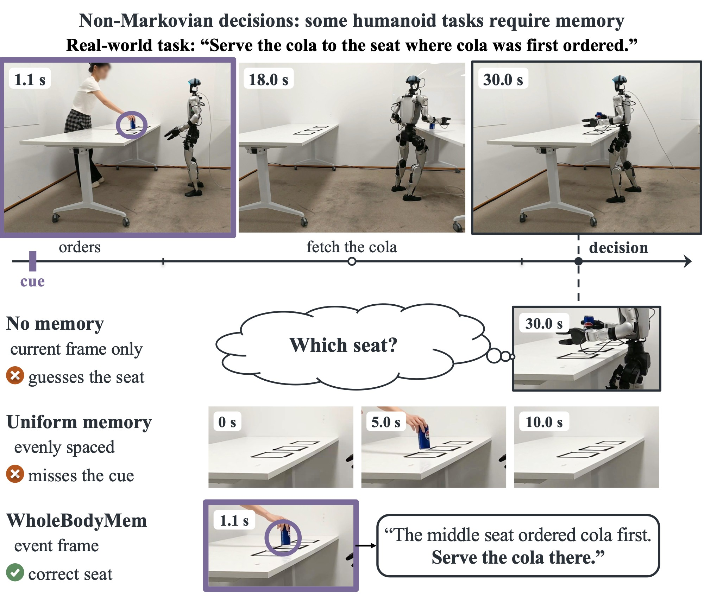

<div align="center">

# Memory before Goal

### Role of Pre-History Memory for Humanoid Loco-Manipulation

Chenyuan Chen · Ran Ding · Lechen Zhang · Zewen He · Yoshihiko Nakamura

MBZUAI

[**Project page**](https://memory-before-goal.github.io) &nbsp;|&nbsp; [**arXiv**](https://arxiv.org/abs/2610.31166) &nbsp;|&nbsp; [**Dataset**](https://huggingface.co/collections/ChenyuanC/humego-6ada5cbea74d4cc678c91c68) &nbsp;|&nbsp; *In submission, 2026*



</div>

Humanoid loco-manipulation in dynamic scenes is non-Markovian: cues vanish as objects change or are hidden, or leave the view as the robot turns and walks, yet whole-body vision-language-action (VLA) policies see only the present. We present WholeBodyMem, an object-guided perceptual memory that keeps the pre-history of object events seen before the robot acts on its goal. SAM3 tracks the task objects, and their events causally select key frames within an adaptive budget, which the action expert reads by cross-attention together with object tokens encoding appearance, geometry and time. We also contribute HuMeGo, a humanoid memory benchmark with six simulated and six real-world Unitree G1 tasks.

## HuMeGo dataset

All datasets are in [LeRobot](https://github.com/huggingface/lerobot) v2.1 format on Hugging Face ([collection](https://huggingface.co/collections/ChenyuanC/humego-6ada5cbea74d4cc678c91c68)) and are released under CC BY 4.0.

**Simulation** (Unitree G1, 50 Hz, head camera): 100 demonstrations per task for training and 90 test scenes per task (30 per randomization level L0 / L1 / L2).

| Task | Memory | Training | Test scenes |
|---|---|---|---|
| FlashPad | counting | [HuMeGo-Sim-FlashPad](https://huggingface.co/datasets/ChenyuanC/HuMeGo-Sim-FlashPad) | [HuMeGo-Sim-TestScenes/FlashPad](https://huggingface.co/datasets/ChenyuanC/HuMeGo-Sim-TestScenes/tree/main/FlashPad) |
| HideMug | permanence | [HuMeGo-Sim-HideMug](https://huggingface.co/datasets/ChenyuanC/HuMeGo-Sim-HideMug) | [HuMeGo-Sim-TestScenes/HideMug](https://huggingface.co/datasets/ChenyuanC/HuMeGo-Sim-TestScenes/tree/main/HideMug) |
| ShellGame | permanence | [HuMeGo-Sim-ShellGame](https://huggingface.co/datasets/ChenyuanC/HuMeGo-Sim-ShellGame) | [HuMeGo-Sim-TestScenes/ShellGame](https://huggingface.co/datasets/ChenyuanC/HuMeGo-Sim-TestScenes/tree/main/ShellGame) |
| LitLamp | reference | [HuMeGo-Sim-LitLamp](https://huggingface.co/datasets/ChenyuanC/HuMeGo-Sim-LitLamp) | [HuMeGo-Sim-TestScenes/LitLamp](https://huggingface.co/datasets/ChenyuanC/HuMeGo-Sim-TestScenes/tree/main/LitLamp) |
| BlinkPad | reference | [HuMeGo-Sim-BlinkPad](https://huggingface.co/datasets/ChenyuanC/HuMeGo-Sim-BlinkPad) | [HuMeGo-Sim-TestScenes/BlinkPad](https://huggingface.co/datasets/ChenyuanC/HuMeGo-Sim-TestScenes/tree/main/BlinkPad) |
| TouchPad | reference | [HuMeGo-Sim-TouchPad](https://huggingface.co/datasets/ChenyuanC/HuMeGo-Sim-TouchPad) | [HuMeGo-Sim-TestScenes/TouchPad](https://huggingface.co/datasets/ChenyuanC/HuMeGo-Sim-TestScenes/tree/main/TouchPad) |

**Real world** (Unitree G1 with SONIC whole-body teleoperation, 30 fps head camera): 15 demonstrations per task.

| Task | Memory | Dataset |
|---|---|---|
| Trash bag | where | [HuMeGo-Real-TrashBag](https://huggingface.co/datasets/ChenyuanC/HuMeGo-Real-TrashBag) |
| Remember-chip | what | [HuMeGo-Real-RememberChip](https://huggingface.co/datasets/ChenyuanC/HuMeGo-Real-RememberChip) |
| Café A: first come, first served | when | [HuMeGo-Real-CafeA](https://huggingface.co/datasets/ChenyuanC/HuMeGo-Real-CafeA) |
| Café B: which seat has the cola | what + where | [HuMeGo-Real-CafeB](https://huggingface.co/datasets/ChenyuanC/HuMeGo-Real-CafeB) |
| Café C: where did the cola stop first | what + where + when | [HuMeGo-Real-CafeC](https://huggingface.co/datasets/ChenyuanC/HuMeGo-Real-CafeC) |
| Chip-cart | progress | [HuMeGo-Real-ChipCart](https://huggingface.co/datasets/ChenyuanC/HuMeGo-Real-ChipCart) |

## Code and models

Coming soon.

## Citation

```bibtex
@misc{chen2026memorybeforegoal,
      title={Memory before Goal: Role of Pre-History Memory for Humanoid Loco-Manipulation},
      author={Chenyuan Chen and Ran Ding and Lechen Zhang and Zewen He and Yoshihiko Nakamura},
      year={2026},
      eprint={2610.31166},
      archivePrefix={arXiv},
      primaryClass={cs.RO},
      url={https://arxiv.org/abs/2610.31166},
}
```
