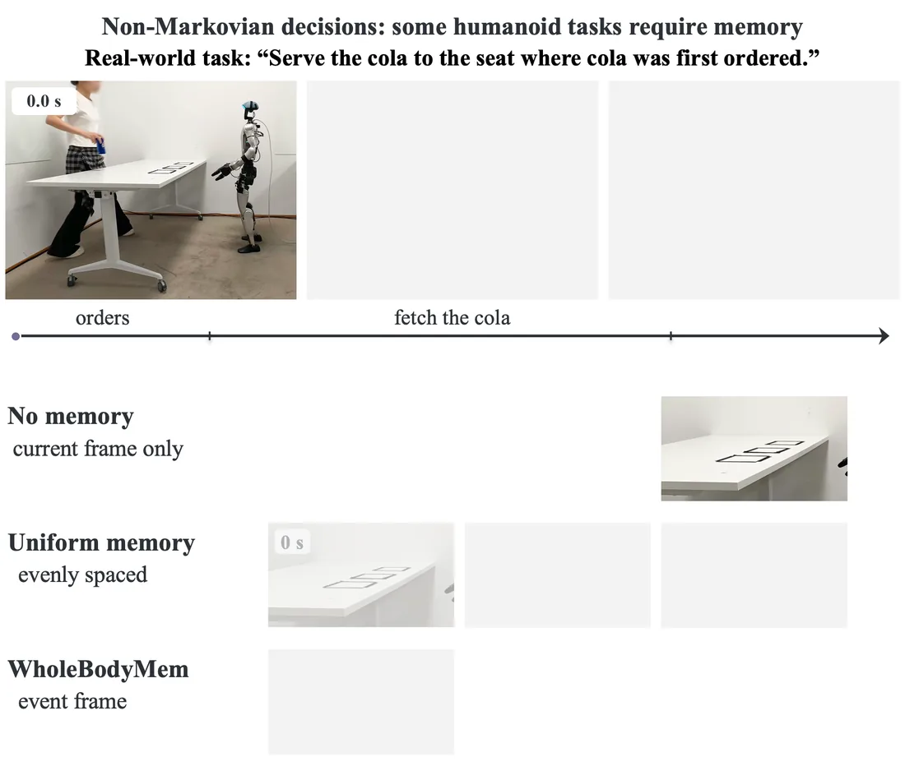

<div align="center">

<h2>Memory before Goal: <br> Role of Pre-History Memory for Humanoid Loco-Manipulation</h2>

<p>
  <b>Chenyuan Chen</b> &nbsp;·&nbsp;
  <b>Ran Ding</b> &nbsp;·&nbsp;
  <b>Lechen Zhang</b> &nbsp;·&nbsp;
  <b>Zewen He</b> &nbsp;·&nbsp;
  <b>Yoshihiko Nakamura</b>
  <br>
  <sub>MBZUAI</sub>
</p>

<div align="center">
  <a href='https://arxiv.org/abs/2610.31166'></a>  &ensp;
  <a href='https://memory-before-goal.github.io'></a>  &ensp;
  <a href='https://huggingface.co/ChenyuanC/MemorybeforeGoal'></a>  &ensp;
  <a href='https://huggingface.co/collections/ChenyuanC/humego-6ada5cbea74d4cc678c91c68'></a>  &ensp;
  <a href='LICENSE'></a>  &ensp;
</div>

<br>



</div>

---

## 📢 News

- **2026-11-04** — Released the inference code for HuMeGo memory tasks and baseline tasks.
- **2026-11-03** — Released 51 checkpoints at [`ChenyuanC/MemorybeforeGoal`](https://huggingface.co/ChenyuanC/MemorybeforeGoal): WholeBodyMem and the Psi0 baseline of the paper's tables.
- **2026-10-23** — Released the [HuMeGo datasets](https://huggingface.co/collections/ChenyuanC/humego-6ada5cbea74d4cc678c91c68): six simulated tasks with their test scenes and six real-world tasks.

## Table of Contents
- [Installation](#installation)
- [Quick Start](#quick-start)
  - [Checkpoints](#checkpoints)
  - [Policy server in simulation](#policy-server)
- [HuMeGo Benchmark](#humego)
  - [Simulation tasks](#humego-sim)
  - [Real-world tasks](#humego-real)
- [License](#license)
- [Citation](#citation)

<a id="installation"></a>
## 🔧 Installation

```bash
git clone https://github.com/crystalccy1/MemoryBeforeGoal.git && cd MemoryBeforeGoal
conda create -n wholebodymem python=3.10 -y && conda activate wholebodymem
pip install torch==2.7.0 torchvision==0.22.0 \
    --index-url https://download.pytorch.org/whl/cu128
pip install -r requirements/policy.txt && pip install -e ".[tracker,examples]"

# SAM 3 at a fixed code revision, with the original weights
git clone https://github.com/facebookresearch/sam3 third_party/sam3
git -C third_party/sam3 checkout 2345a4ad109ac29c569da749c91d84f10dc08c40
hf auth login      # the weights are gated, see below
hf download facebook/sam3 sam3.pt --local-dir weights/sam3 \
    --revision 3c879f39826c281e95690f02c7821c4de09afae7
```

> Inference needs an NVIDIA GPU (we used one 48 GB GPU). The SAM 3 weights are gated: request access on
> [facebook/sam3](https://huggingface.co/facebook/sam3) before downloading.

<a id="quick-start"></a>
## 🚀 Quick Start

<a id="checkpoints"></a>
### Checkpoints

| Checkpoint | Tasks | Paper |
|:---|:---|:---:|
| `wholebodymem/memory/<Task>` | BlinkPad, TouchPad, FlashPad, LitLamp, HideMug, ShellGame | Table III |
| `wholebodymem/simple/<Task>` | the 14 SIMPLE tasks, `T1_XMovePick` to `T14_BendPick` | Table I |
| `wholebodymem/real/<Task>` | TrashBag, RememberChip, CafeA, CafeB, CafeC, ChipCart (Unitree G1) | Table V |
| `baselines/psi0/{memory,simple,real}/<Task>` | Psi0 fine-tuned per task | Tables III, I, V |

All are folders of [`ChenyuanC/MemorybeforeGoal`](https://huggingface.co/ChenyuanC/MemorybeforeGoal);
`scripts/download.py` downloads one (`--method`, `--suite`, `--task`).

<a id="policy-server"></a>
### Policy server in simulation

```bash
# 1. download a checkpoint (or --suite simple --task T1_XMovePick)
python scripts/download.py --task LitLamp --out checkpoints

# 2. start the policy server with the online SAM 3 memory
wholebodymem-serve --task LitLamp --bundle checkpoints/wholebodymem/memory/LitLamp \
    --sam3-repo third_party/sam3 --sam3-checkpoint weights/sam3/sam3.pt --port 8000

# 3. in a second shell: replay a recorded episode through the server
python examples/replay_episode.py --task LitLamp --episode 0 --port 8000
```

<details>
<summary><b>Request protocol</b></summary>

<br>

- `POST /reset_rollout` at the start of an episode.
- `POST /act` with the current head-camera image, the robot state, the instruction and the frames executed since the
  previous request; it returns the next 24 actions.
- `GET /health` returns the configuration and the memory state.

The message format is in [`src/wholebodymem/server.py`](src/wholebodymem/server.py);
[`examples/replay_episode.py`](examples/replay_episode.py) is a complete client.

</details>

<a id="humego"></a>
## 📦 HuMeGo Benchmark

All datasets are in [LeRobot](https://github.com/huggingface/lerobot) v2.1 format on Hugging Face ([collection](https://huggingface.co/collections/ChenyuanC/humego-6ada5cbea74d4cc678c91c68)) and are released under CC BY 4.0.

<a id="humego-sim"></a>
### Simulation tasks

100 demonstrations per task for training and 90 test scenes per task (30 per randomization level L0 / L1 / L2).

| Task | Memory | Training | Test scenes |
|---|---|---|---|
| FlashPad | counting | [HuMeGo-Sim-FlashPad](https://huggingface.co/datasets/ChenyuanC/HuMeGo-Sim-FlashPad) | [HuMeGo-Sim-TestScenes/FlashPad](https://huggingface.co/datasets/ChenyuanC/HuMeGo-Sim-TestScenes/tree/main/FlashPad) |
| HideMug | permanence | [HuMeGo-Sim-HideMug](https://huggingface.co/datasets/ChenyuanC/HuMeGo-Sim-HideMug) | [HuMeGo-Sim-TestScenes/HideMug](https://huggingface.co/datasets/ChenyuanC/HuMeGo-Sim-TestScenes/tree/main/HideMug) |
| ShellGame | permanence | [HuMeGo-Sim-ShellGame](https://huggingface.co/datasets/ChenyuanC/HuMeGo-Sim-ShellGame) | [HuMeGo-Sim-TestScenes/ShellGame](https://huggingface.co/datasets/ChenyuanC/HuMeGo-Sim-TestScenes/tree/main/ShellGame) |
| LitLamp | reference | [HuMeGo-Sim-LitLamp](https://huggingface.co/datasets/ChenyuanC/HuMeGo-Sim-LitLamp) | [HuMeGo-Sim-TestScenes/LitLamp](https://huggingface.co/datasets/ChenyuanC/HuMeGo-Sim-TestScenes/tree/main/LitLamp) |
| BlinkPad | reference | [HuMeGo-Sim-BlinkPad](https://huggingface.co/datasets/ChenyuanC/HuMeGo-Sim-BlinkPad) | [HuMeGo-Sim-TestScenes/BlinkPad](https://huggingface.co/datasets/ChenyuanC/HuMeGo-Sim-TestScenes/tree/main/BlinkPad) |
| TouchPad | reference | [HuMeGo-Sim-TouchPad](https://huggingface.co/datasets/ChenyuanC/HuMeGo-Sim-TouchPad) | [HuMeGo-Sim-TestScenes/TouchPad](https://huggingface.co/datasets/ChenyuanC/HuMeGo-Sim-TestScenes/tree/main/TouchPad) |

<a id="humego-real"></a>
### Real-world tasks

15 demonstrations per task.

| Task | Memory | Dataset |
|---|---|---|
| Trash bag | where | [HuMeGo-Real-TrashBag](https://huggingface.co/datasets/ChenyuanC/HuMeGo-Real-TrashBag) |
| Remember-chip | what | [HuMeGo-Real-RememberChip](https://huggingface.co/datasets/ChenyuanC/HuMeGo-Real-RememberChip) |
| Café A: first come, first served | when | [HuMeGo-Real-CafeA](https://huggingface.co/datasets/ChenyuanC/HuMeGo-Real-CafeA) |
| Café B: which seat has the cola | what + where | [HuMeGo-Real-CafeB](https://huggingface.co/datasets/ChenyuanC/HuMeGo-Real-CafeB) |
| Café C: where did the cola stop first | what + where + when | [HuMeGo-Real-CafeC](https://huggingface.co/datasets/ChenyuanC/HuMeGo-Real-CafeC) |
| Chip-cart | progress | [HuMeGo-Real-ChipCart](https://huggingface.co/datasets/ChenyuanC/HuMeGo-Real-ChipCart) |

<a id="license"></a>
## 📜 License

| Part | License |
|---|---|
| Code | Apache License 2.0 ([LICENSE](LICENSE), [NOTICE](NOTICE)) |
| Checkpoints | Apache License 2.0 |
| HuMeGo datasets | CC BY 4.0 |
| SAM 3 code and weights (not included) | Meta's SAM License |

<a id="citation"></a>
## 📖 Citation

```bibtex
@misc{chen2026memorybeforegoal,
      title={Memory before Goal: Role of Pre-History Memory for Humanoid Loco-Manipulation},
      author={Chenyuan Chen and Ran Ding and Lechen Zhang and Zewen He and Yoshihiko Nakamura},
      year={2026},
      eprint={2610.31166},
      archivePrefix={arXiv},
      primaryClass={cs.RO},
      url={https://arxiv.org/abs/2610.31166},
}
```
